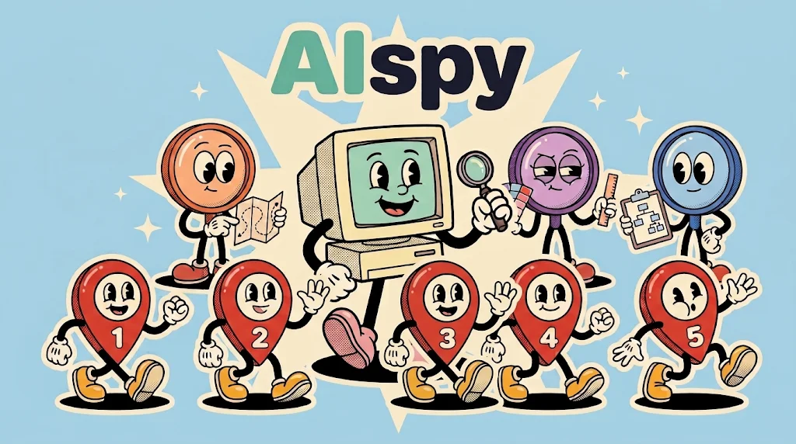
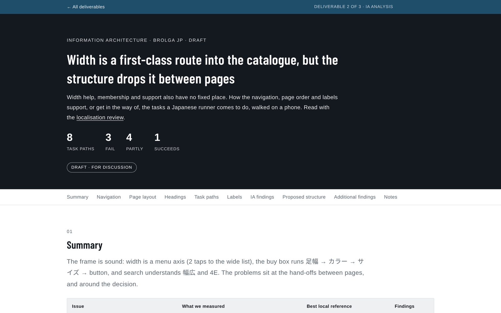
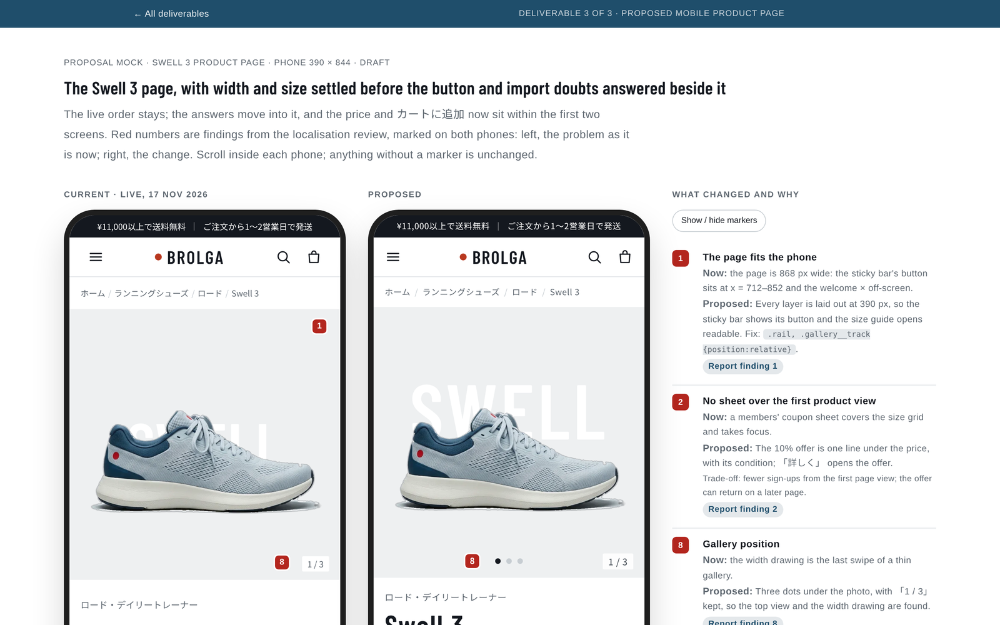

# AIspy



**A second pair of eyes for your UX, UI and IA.**

AIspy is a set of Claude skills that runs a professional UX/UI/IA review of a live website or app,
with an optional market-localisation layer. Give it a product; it captures the pages, extracts the
design system, researches the market and benchmarks, runs three independent review lenses, and
delivers:

- a **review report**: findings grouped by cause, each with annotated evidence and a site that does it well;
- an **IA analysis**: navigation, page layout by type, heading hierarchy, task paths, label audit and a proposed structure;
- a **current-vs-proposed mock** of the key screen, built in the product's own design system;
- an **index page** that ties the three together.

All four are styled in the reviewed product's own design system. AIspy replicates a reference
review made by a senior designer, and was tested against it (November 2026): its research and
findings at least match the reference, and its documents follow the same form.

It supports a senior reviewer; it doesn't replace one. It stops for your review after the report,
again after the mock, and before packaging.

## What you get

From the example package in [`examples/brolga/`](examples/brolga/), a localisation review of a
fictional running-shoe brand selling in Japan:

| Review report | IA analysis | Mock |
|---|---|---|
|  |  |  |

## Install

Requires [Claude Code](https://code.claude.com), in the terminal or the desktop app's Code tab,
and Node 22.23.5 or newer.

AIspy installs into Claude Code as a skill pack. Either:

**With Claude Code's `/plugin` command:**

```
/plugin marketplace add stevensmith-design/aispy
/plugin install aispy@aispy
```

**Or from a clone**, starting Claude Code with it loaded:

```
git clone https://github.com/stevensmith-design/aispy.git
claude --plugin-dir ./aispy
```

To keep it with a project, put the folder inside it and start Claude Code with `--plugin-dir` and
that path. Keep the folder whole: the skills find their scripts two folders up.

Either way, eight skills become available: `product-review` and `review-scoping`, plus the six
design-kit skills they call (`ui-design-system`, `ui-design-review`, `ia-review`, `design-refine`,
`ui-design-principles`, `distinctiveness-review`). The design kit is bundled. To confirm AIspy is
loaded, run `/plugin` (or `claude --plugin-dir ./AIspy plugin details aispy`) and look for the
eight skills; tested, the bare names resolve to AIspy's copies even when other copies of the kit
are installed.

**Before the first review**, set up what the setup check needs, or it stops:

1. **Screenshots:** install the capture helper (Playwright), which makes the evidence crops.
   ```
   cd AIspy/scripts/capture && npm install && npx playwright install chromium
   ```
2. **A browser the session can drive**, such as Claude in Chrome or Playwright, with its commands
   allowed in your permissions so it can open the site.
3. **Agents:** say "start separate agents for the lenses and checks" in your request.

## How to start

The only thing it needs is the product: a URL, a store link, or screens.

```
Review https://example.com and propose improvements. Start separate agents for the lenses and checks.
```
```
Here's the client's request: <paste>. My direction: focus on mobile checkout, and they're
launching in Japan, so include a localisation review. Report in English.
```
```
Extract the brand and design system from https://example.com first; we'll review afterwards.
```

It takes a quick look, then asks one batch of questions with a proposed default for each, so "go"
is enough. Before reviewing, it runs a setup check (agents, browser, screenshots, kit) and stops if
anything fails.

## How to use

[docs/how-to-use.md](docs/how-to-use.md) covers it in full. In short:

- **Live site:** the URL is enough. Better, also save each page in scope as HTML ("Save page as",
  complete) and connect the folder.
- **Staging or local site:** give the served build or a reachable URL, never the source project
  (the source holds the design intent and biases the review).
- **Logged-in areas:** you sign in yourself in the browser; the pack never handles credentials.
- **Native app:** a simulator or emulator the session can see and operate, or exported screens per
  flow with the sweep done by hand. Tap areas are less exact than on the web.
- **Say in the request:** review type (general, or plus localisation), priority device, pages or
  flows, language, and "start separate agents for the lenses and checks".

## What to expect

Three stops, one review round from you at each:

1. **Review report and IA analysis.** The deliverables step takes about 40 minutes from a finished review.
2. **Mock spec, then the mock.** About 25 minutes, including the spec and checks.
3. **Packaging:** the index page and the final package.

Times are from the test runs. Everything is written to `review/<product>-<date>/` in the folder you
connected, with a run log.

**Accessibility:** it checks contrast, text size, tap targets, alt text, screen-reader strings,
headings and motion. It is not a full WCAG audit, and it doesn't do a screen-reader or
keyboard-only walk unless you ask.

## Contents

```
.claude-plugin/       plugin and marketplace manifests
skills/
  product-review/     SKILL.md (the workflow), references/ (checklist, review questions,
                      deliverable outlines), templates/ (the four documents; see templates/README.md)
  review-scoping/     optional: inventory a big site and pick pages by type
  design-kit/         the six design-kit skills the pack calls (see design-kit/PROVENANCE.md)
scripts/              optional helpers, not required steps
  capture/            capture.mjs, extract-in-page.js, sweep-in-page.js, annotate.mjs (evidence crops)
  inventory/          inventory.mjs (sitemap, page types, broken URLs)
  build/              theme-from-tokens.mjs, assemble.mjs, layout-bars.mjs
  checks/             check-deliverable.mjs, check-report.mjs, check-mock.mjs, forbid.mjs
                      (tests: node --test scripts/checks/test/)
examples/brolga/      a complete example package
docs/how-to-use.md    inputs by product type, and what to expect
```

## How AIspy is designed

Consistent results come from defining the deliverables, not from leaving them to the agent.

1. **Goals:** what each deliverable is for and who reads it.
2. **Data required:** what evidence, research, benchmarks and extraction each one needs.
3. **How it's put together:** the required contents, structure and layout of the report, IA
   analysis, mock and index, as rules, templates and examples. This is the baseline; an agent may
   add something new with a stated reason, but never starts from a blank page.
4. **Methods:** how to capture, extract, research, benchmark and review. This is where the agent's
   judgement works: what it finds, how serious it is, and what to propose.

## How it improves

Through use, measured against the reference review. Treat any report that something is missing or
worse as a gap in replicating the reference: check what the reference does, then repair the
existing instruction or reference file. When a real run misses something, add one line to
`skills/product-review/references/checklist.md`. A new requirement or step goes in only for a
demonstrated gap, or when a run shows it beats the reference on quality or cost.

## Status

0.7.0, the first public version. See [CHANGELOG.md](CHANGELOG.md) for the history and
[ROADMAP.md](ROADMAP.md) for what's next.

## Licence

Code, skills and templates: [MIT](LICENSE). The bundled design kit keeps its own MIT licence and
notice (`skills/design-kit/LICENSE`, `NOTICE`). The example package in `examples/brolga/` is
[CC BY 4.0](examples/brolga/LICENSE.md).

The AIspy name, logo and character artwork (including the image at the top of this page) are
not covered by these licences.
