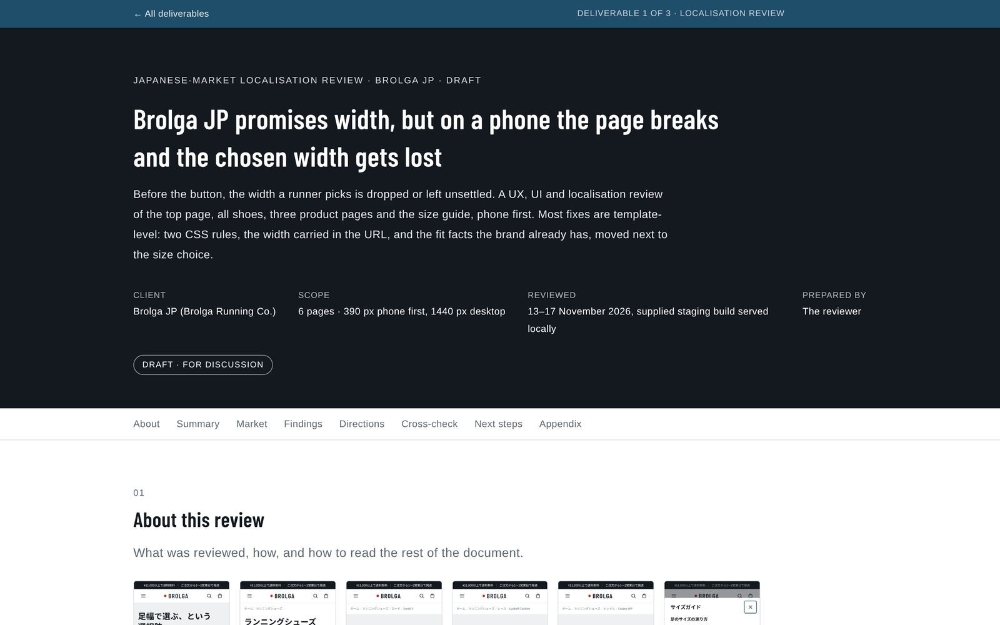

# AIspy


**A full UX, UI and IA review from your AI crew.**

Made by Steven Smith. More on AIspy and my other work: [stevensmith.dev/aispy](https://stevensmith.dev/aispy?utm_source=github&utm_campaign=aispy)

| Review report | IA analysis | Mock |
|---|---|---|
|  |  |  |

<sub>Real output from a full AIspy run on Brolga, a fictional running-shoe brand selling in Japan. The standard every run is held to is [`examples/mareo/`](examples/mareo/), the reference review recreated on a fictional store. More under [Examples](#examples).</sub>

For product managers, founders, developers and marketers without a senior designer to hand, and for designers and agent-led teams who want a full review to start from.

AIspy is a skill pack for Claude Code that runs a professional UX/UI/IA review with an optional market-localisation layer. Give it a product; it captures the pages, extracts the design system, researches the market and benchmarks, runs three independent review lenses, and
delivers:

- a **review report**: findings grouped by cause, each with annotated evidence and a site that does it well;
- an **IA analysis**: navigation, page layout by type, heading hierarchy, task paths, label audit and a proposed structure;
- a **current-vs-proposed mock** of the key screen, built in the product's own design system;
- an **index page** that ties the three together.

All four are styled in the reviewed product's own design system. AIspy replicates a reference
review made by a senior designer, and was tested against it (November 2026): its research and
findings at least match the reference, and its documents follow the same form.

It supports a reviewer; it doesn't replace one. It stops for your review after the report,
again after the mock, and before packaging.

## Quick start

**From a clone or download** (nothing to install into Claude Code):

1. **Get AIspy:** `git clone https://github.com/stevensmith-design/aispy.git`, or download the ZIP
   from GitHub and rename the unzipped folder (`aispy-main`) to `aispy`. Open Claude Code in the
   folder that contains `aispy` (your project, for example), or connect the `aispy` folder to a
   session alongside your project.
2. **Ask Claude:** "Set up AIspy for my first review". It installs the screenshot helper and tests
   a scripted browser; approve the install and browser commands when it asks.
3. **Ask for a review:** "Use the AIspy kit in ./aispy to review https://example.com. Start
   separate agents for the lenses and checks." With the folder connected separately, say "the
   AIspy kit in the connected aispy folder".

**Or install it as a plugin:**

1. **Get AIspy:** `/plugin marketplace add stevensmith-design/aispy`, then
   `/plugin install aispy@aispy`. From a local copy: `/plugin marketplace add ./aispy`, then the
   same install command.
2. **Ask Claude:** "Set up AIspy for my first review". It offers to install the screenshot helper
   and test the browser; say yes and approve the commands.
3. **Ask for a review:** "Use the AIspy kit to review https://example.com. Start separate agents
   for the lenses and checks."

Each review starts with a setup check (agents, the browser reaching your site, screenshots, the
kit) and stops if anything fails. The manual commands are under [Install](#install).

### クイックスタート（日本語）

**クローンまたはダウンロードして使う**（Claude Code へのインストールは不要）

1. **AIspy を入手する：** `git clone https://github.com/stevensmith-design/aispy.git` を実行するか、
   GitHub から ZIP をダウンロードし、展開したフォルダ（`aispy-main`）の名前を `aispy` に変更します。
   `aispy` が入っているフォルダ（作業中のプロジェクトなど）で Claude Code を開くか、`aispy`
   フォルダをプロジェクトと一緒にセッションに接続します。
2. **Claude に依頼する：**「AIspy の初回レビューの準備をして」。スクリーンショット用のツールを
   インストールし、ブラウザの自動操作をテストします。インストールやブラウザのコマンドの許可を
   求められたら承認してください。
3. **レビューを依頼する：**「./aispy の AIspy キットで https://example.com をレビューして。
   レビュー観点とチェックは別々のエージェントで実行して。」フォルダを別に接続している場合は
   「接続した aispy フォルダの AIspy キットで」と伝えます。

**プラグインとしてインストールして使う**

1. **AIspy を入手する：** `/plugin marketplace add stevensmith-design/aispy` を実行したあと、
   `/plugin install aispy@aispy` を実行します。ローカルのコピーから入れる場合は
   `/plugin marketplace add ./aispy` のあと、同じインストールコマンドを実行します。
2. **Claude に依頼する：**「AIspy の初回レビューの準備をして」。スクリーンショット用のツールの
   インストールとブラウザのテストを提案してくるので、了承してコマンドを承認してください。
3. **レビューを依頼する：**「AIspy キットで https://example.com をレビューして。レビュー観点と
   チェックは別々のエージェントで実行して。」

レビューは毎回、セットアップチェック（エージェント、サイトへのブラウザ接続、スクリーンショット、
キット）から始まり、どれかが失敗するとそこで止まります。手動で実行するコマンドは
[Install](#install) にあります。

## Examples

Two example packages. Each document is one self-contained HTML file; open `index.html` in a
browser to start.

| | [`examples/mareo/`](examples/mareo/) | [`examples/brolga/`](examples/brolga/) |
|---|---|---|
| What it is | The review AIspy was built and tested against, recreated on a fictional Danish sofa brand selling in Japan. It isn't a kit run: it shows what the kit aims at. | A full AIspy run on a fictional Australian running-shoe brand selling in Japan, reviewed once by a person. |
| Scope | One product page at 390 px, with the header, menu drawer and search. Sections that need other pages are kept and labelled "out of scope in this example". | The top page, all shoes, three product pages and the size guide; phone first, desktop where a finding differs. |
| What it shows | The standard the skill matches by default: document form, density of argument, how evidence is marked, and the mock. Also the store's product page before and after. | What a complete multi-page package looks like, from intake to the finished documents. |
| Documents | Index, localisation review (13 findings), IA analysis, mock, mock spec | Index, review report (18 findings), IA analysis, mock, mock spec |

Both pass the pack's checks (`scripts/checks/`). The examples' stores and products are made up;
real Japanese sites appear only as benchmarks.

## Install

Requires [Claude Code](https://code.claude.com), in the terminal or the desktop app's Code tab,
Node 22.23.5 or newer, and Python 3 (for the design-system validator, `validate-tokens.py`).

Built and tested in Claude Code. Also tested in Codex (November 2026): see
[docs/other-agents.md](docs/other-agents.md).

AIspy installs into Claude Code as a skill pack. Either:

**With Claude Code's `/plugin` command:**

```
/plugin marketplace add stevensmith-design/aispy
/plugin install aispy@aispy
```

**Or from a clone**, starting Claude Code with it loaded:

```
git clone https://github.com/stevensmith-design/aispy.git
claude --plugin-dir ./aispy
```

To keep it with a project, put the folder inside it and start Claude Code with `--plugin-dir` and
that path. Keep the folder whole: the skills find their scripts two folders up.

Either way, eight skills become available: `product-review` and `review-scoping`, plus the six
design-kit skills they call (`ui-design-system`, `ui-design-review`, `ia-review`, `design-refine`,
`ui-design-principles`, `distinctiveness-review`). The design kit is bundled. To confirm AIspy is
loaded, run `/plugin` (or `claude --plugin-dir ./aispy plugin details aispy`) and look for the
eight skills; tested, the bare names resolve to AIspy's copies even when other copies of the kit
are installed.

**Before the first review**, set up what the setup check needs, or it stops:

1. **Screenshots:** install the capture helper (Playwright), which makes the evidence crops. Run
   it in the pack's `scripts/capture/` folder:
   - **From a clone**, in the folder where you ran `git clone`:
     ```
     cd aispy/scripts/capture && npm install && npx playwright install chromium
     ```
   - **With `/plugin` from a local copy** (`/plugin marketplace add ./aispy`): as from a clone. The
     plugin runs from that folder.
   - **With `/plugin` from GitHub**, in any folder. Claude Code keeps the plugin in a folder named
     after the installed version; this picks the newest installed version. Run it again after each
     update:
     ```
     cd "$(ls -d ~/.claude/plugins/cache/aispy/aispy/*/ | sort -V | tail -1)scripts/capture" && npm install && npx playwright install chromium
     ```
2. **A browser the session can drive**, such as Claude in Chrome or Playwright, with its commands
   allowed in your permissions so it can open the site.
3. **Agents:** say "start separate agents for the lenses and checks" in your request.

## How to start

The only thing it needs is the product: a URL, a store link, or screens.

```
Review https://example.com and propose improvements. Start separate agents for the lenses and checks.
```
```
Here's the brief: <paste>. My direction: focus on mobile checkout, and the store is
launching in Japan, so include a localisation review. Report in English.
```
```
Extract the brand and design system from https://example.com first; we'll review afterwards.
```

It takes a quick look, then asks one batch of questions with a proposed default for each, so "go"
is enough. Before reviewing, it runs a setup check (agents, browser, screenshots, kit) and stops if
anything fails.

### 始め方（日本語）

必要なのはプロダクトだけです。URL、ストアのリンク、または画面のどれかを渡してください。

```
https://example.com をレビューして、改善案を出して。レビュー観点とチェックは別々のエージェントで実行して。
```
```
ブリーフはこちら：<貼り付け>。方針：モバイルの購入手続きを重点的に見てほしい。日本市場でローンチ
するので、ローカライズのレビューも含めて。レポートは日本語で。
```
```
まず https://example.com からブランドとデザインシステムを抽出して。レビューはそのあとで。
```

まずサイトをざっと確認し、質問をまとめて一度に送ります。各質問には既定の案が付いているので、
「進めて」と返すだけで構いません。レビューの前にセットアップチェック（エージェント、ブラウザ、
スクリーンショット、キット）を行い、どれかが失敗するとそこで止まります。

## How to use

[docs/how-to-use.md](docs/how-to-use.md) covers it in full. In short:

- **Live site:** the URL is enough. Better, also save each page in scope as HTML ("Save page as",
  complete) and connect the folder.
- **Staging or local site:** give the served build or a reachable URL, never the source project
  (the source holds the design intent and biases the review).
- **Logged-in areas:** you sign in yourself in the browser; the pack never handles credentials.
- **Native app:** a simulator or emulator the session can see and operate, or exported screens per
  flow with the sweep done by hand. Tap areas are less exact than on the web.
- **Say in the request:** review type (general, or plus localisation), priority device, pages or
  flows, language, and "start separate agents for the lenses and checks".

## What to expect

Three stops, one review round from you at each:

1. **Review report and IA analysis.** The deliverables step takes about 40 minutes from a finished review.
2. **Mock spec, then the mock.** About 25 minutes, including the spec and checks.
3. **Packaging:** the index page and the final package.

Times are from the test runs. Everything is written to `review/<product>-<date>/` in the folder you
connected, with a run log.

**Accessibility:** it checks contrast, text size, tap targets, alt text, screen-reader strings,
headings and motion. It is not a full WCAG audit, and it doesn't do a screen-reader or
keyboard-only walk unless you ask.

## Contents

```
.claude-plugin/       plugin and marketplace manifests
skills/
  product-review/     SKILL.md (the workflow), references/ (checklist, review questions,
                      deliverable outlines), templates/ (the four documents; see templates/README.md)
  review-scoping/     optional: inventory a big site and pick pages by type
  design-kit/         the six design-kit skills the pack calls (see design-kit/PROVENANCE.md)
scripts/              optional helpers, not required steps
  capture/            capture.mjs, extract-in-page.js, sweep-in-page.js, annotate.mjs (evidence crops)
                      (tests: node --test scripts/capture/test/)
  inventory/          inventory.mjs (sitemap, page types, broken URLs)
  build/              theme-from-tokens.mjs, assemble.mjs, layout-bars.mjs
  checks/             check-deliverable.mjs, check-report.mjs, check-mock.mjs, forbid.mjs
                      (tests: node --test scripts/checks/test/)
examples/mareo/       the reference review recreated on a fictional store (default standard)
examples/brolga/      a complete multi-page example run
docs/how-to-use.md    inputs by product type, and what to expect
```

## How AIspy is designed

Consistent results come from defining the deliverables, not from leaving them to the agent.

1. **Goals:** what each deliverable is for and who reads it.
2. **Data required:** what evidence, research, benchmarks and extraction each one needs.
3. **How it's put together:** the required contents, structure and layout of the report, IA
   analysis, mock and index, as rules, templates and examples. This is the baseline; an agent may
   add something new with a stated reason, but never starts from a blank page.
4. **Methods:** how to capture, extract, research, benchmark and review. This is where the agent's
   judgement works: what it finds, how serious it is, and what to propose.

## How it improves

Through use, measured against the reference review. Treat any report that something is missing or
worse as a gap in replicating the reference: check what the reference does, then repair the
existing instruction or reference file. When a real run misses something, add one line to
`skills/product-review/references/checklist.md`. A new requirement or step goes in only for a
demonstrated gap, or when a run shows it beats the reference on quality or cost.

## Status

0.8.8. See [CHANGELOG.md](CHANGELOG.md) for the history and the
[open issues](https://github.com/stevensmith-design/aispy/issues) for what's next.

## Licence

Code, skills and templates: [MIT](LICENSE). The bundled design kit keeps its own MIT licence and
notice (`skills/design-kit/LICENSE`, `NOTICE`). The example packages are
CC BY 4.0: [`examples/mareo/`](examples/mareo/LICENSE.md) and
[`examples/brolga/`](examples/brolga/LICENSE.md). The Barlow Condensed font embedded in
Brolga's documents is under the SIL Open Font License 1.1, not CC BY (see its `LICENSE.md`).

The AIspy name, logo and character artwork (including the image at the top of this page) are
not covered by these licences.
